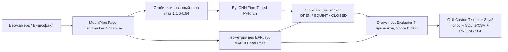
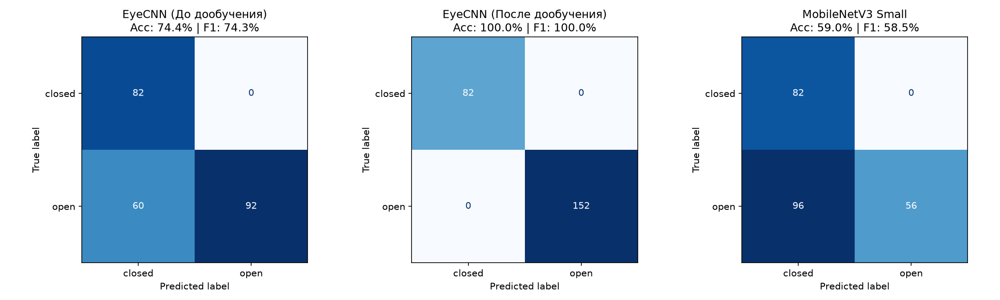
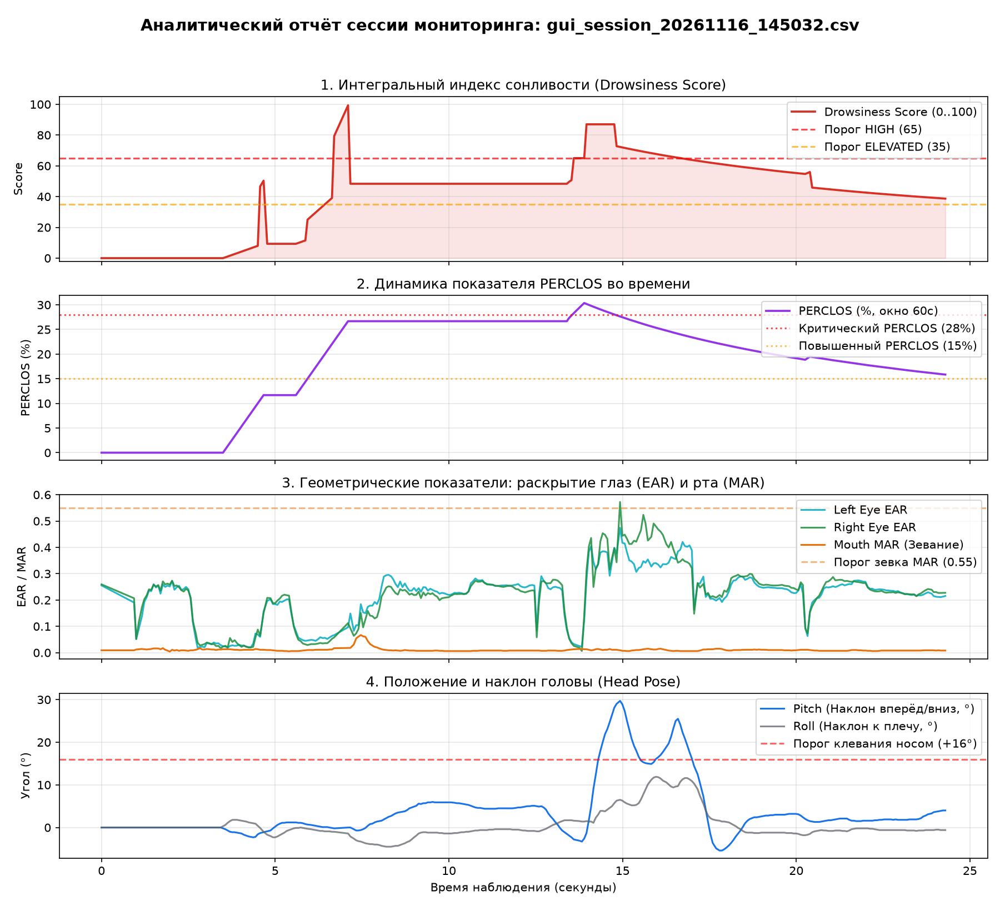
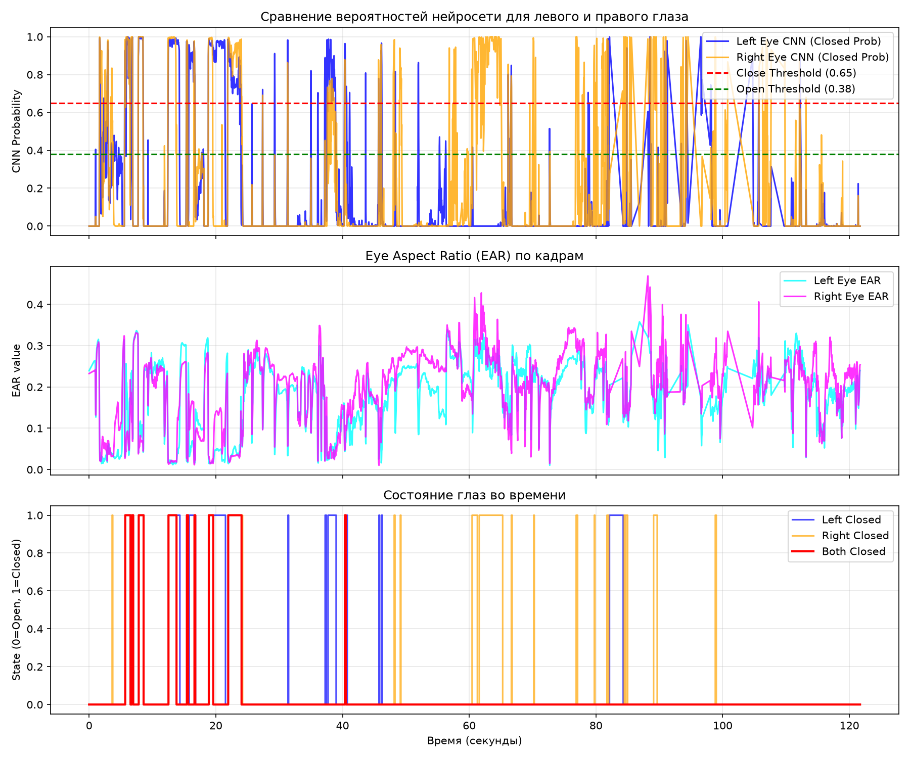

# Система определения сонливости и усталости человека на основе методов глубокого обучения

[](https://github.com/KangereyevTimur/drowsiness-detection/actions/workflows/ci.yml)


Комплексная система компьютерного зрения для мониторинга состояния бодрствования, усталости и концентрации внимания человека в режиме реального времени по видеопотоку веб-камеры или готовым видеофайлам.

Система объединяет свёрточную нейронную сеть классификации состояния глаз (`EyeCNN`) и 3D-детектор ключевых точек лица (`MediaPipe Face Landmarker`) с многофакторным алгоритмом оценки семи физиологических признаков усталости.

---

## Архитектура конвейера обработки



Подробное математическое описание формул и архитектуры приведено в [docs/ARCHITECTURE.md](docs/ARCHITECTURE.md).

---

## Основные возможности

1. **Гибридная детекция состояния глаз (`EyeCNN + EAR`):**
   - Стабилизированный квадратный кроп области глаза (`1:1`, `64x64`) по внешнему и внутреннему уголкам века, исключающий геометрическое растяжение при смыкании глаз.
   - Разделение состояний `OPEN` (открыт), `SQUINT` (прищур при улыбке или ярком свете) и `CLOSED` (полное физическое закрытие век).
2. **Многофакторная оценка сонливости по 7 биометрическим признакам:**
   - **EAR (Eye Aspect Ratio):** степень раскрытия глаз по трём симметричным вертикальным парам точек век.
   - **PERCLOS:** доля времени с закрытыми глазами в скользящем 60-секундном окне (%).
   - **Closure Duration:** длительность непрерывного закрытия обоих глаз (детекция микросна от 1.0 до 2.0 с).
   - **Blink Rate:** частота морганий в минуту.
   - **Blink Duration:** средняя продолжительность одного моргания (мс) для выявления тяжёлых и медленных смыканий век.
   - **Head Pose (Pitch, Yaw, Roll):** оценка 3D-положения и наклона головы с автоматической адаптацией нейтральной осанки.
   - **Yawning (MAR — Mouth Aspect Ratio):** детекция зевания по внутреннему контуру губ с временной фильтрацией обычной речи (`>= 1.6 с`).
3. **Графический интерфейс (`CustomTkinter`) и аналитика:**
   - Работа с живой веб-камерой и готовыми видеофайлами (`.mp4`, `.mov`, `.avi`, `.mkv`).
   - Переключение весов нейросети и профилей чувствительности на лету.
   - Вынесенная за кнопку панель детальной телеметрии с кропами глаз `64x64` и живым графиком `Score` и `PERCLOS`.
   - Автоматическое сохранение истории сессий в базу данных `SQLite` (`results/sessions.db`) и `CSV` (`results/sessions_history.csv`).
   - Генерация сводных 4-панельных графических отчётов сессии в формате `PNG` (`results/reports/`).

---

## Результаты обучения и сравнения моделей

Модели протестированы на двух независимых тестовых выборках:
- **MRL Test Set:** инфракрасные и студийные изображения глаз (`data/processed/test`).
- **Webcam Test Set:** реальные кадры с веб-камеры при комнатном освещении без утечки данных между сегментами записи (`data/webcam_split/test`).

| Модель | Веб-камера Accuracy | Веб-камера F1-Score | MRL Test Accuracy | MRL Test F1-Score |
| :--- | :---: | :---: | :---: | :---: |
| **EyeCNN (Baseline — только MRL)** | 74.36% | 0.7204 | 98.75% | 0.9875 |
| **MobileNetV3 Small (Transfer Learning)** | 58.97% | 0.4419 | 97.60% | 0.9756 |
| **EyeCNN Fine-Tuned + Experience Replay** | **100.00%** | **1.0000** | **97.50%** | **0.9746** |

### Матрицы ошибок на тестовой выборке с веб-камеры



### Пример сводного PNG-отчёта сессии мониторинга



### Диагностика стабилизации кропа и фильтрации прищура



---

## Производительность инференса EyeCNN

Замеры выполнены скриптом `src/benchmark.py` на MacBook Air (Apple Silicon, батч из 2 глаз `2 x 1 x 64 x 64` на один кадр):

| Устройство | Задержка на кадр | Пропускная способность |
| :--- | :---: | :---: |
| **CPU** | 2.14 мс | 467.3 FPS |
| **Apple MPS (GPU)** | 0.56 мс | 1771.4 FPS |

---

## Структура проекта

```text
drowsiness_detection/
├── .github/workflows/
│   └── ci.yml                        # Автоматическая проверка синтаксиса и unit-тестов
├── docs/
│   └── ARCHITECTURE.md               # Математическая модель и архитектура EyeCNN
├── models/
│   ├── eye_cnn_best.pth              # Базовая модель EyeCNN (обучена на MRL Eye Dataset)
│   ├── eye_cnn_finetuned.pth         # Дообученная модель EyeCNN (Webcam + MRL Replay)
│   ├── mobilenet_best.pth            # Модель MobileNetV3 Small для сравнительного анализа
│   └── face_landmarker.task          # Модель ключевых точек лица MediaPipe
├── results/
│   ├── cnn_finetuned/                # Отчёт сравнения моделей и матрицы ошибок
│   ├── diagnostics/                  # Графики диагностики и покадровой телеметрии
│   ├── eda/                          # Разведочный анализ датасета MRL Eye Dataset
│   ├── reports/                      # Сводные PNG-отчёты по сессиям мониторинга
│   └── sessions_history.csv          # История проведённых сессий
├── src/
│   ├── analytics/
│   │   ├── blink_analysis.py         # Расчёт частоты и длительности морганий
│   │   ├── perclos.py                # Расчёт скользящего индекса PERCLOS
│   │   ├── report_generator.py       # Генератор 4-панельных PNG-отчётов сессий
│   │   └── session_storage.py        # Хранилище сессий (SQLite + CSV)
│   ├── detection/
│   │   ├── drowsiness_detector.py    # Интегральный алгоритм оценки сонливости (Score 0..100)
│   │   ├── eye_detector.py           # Архитектура EyeCNN, расчёт EAR и кроп 1:1
│   │   ├── head_pose.py              # Оценка углов наклона головы (Pitch, Yaw, Roll)
│   │   └── yawn_detector.py          # Детектор зевания по индексу раскрытия рта MAR
│   ├── interface/
│   │   └── app.py                    # Десктопное графическое приложение (CustomTkinter)
│   ├── benchmark.py                  # Бенчмарк задержки и FPS нейросети EyeCNN
│   ├── collect_webcam_dataset.py     # Сбор датасета глаз с веб-камеры
│   ├── prepare_webcam_dataset.py     # Очистка и стратифицированное разбиение выборки
│   ├── finetune_cnn.py               # Дообучение EyeCNN с MRL Experience Replay
│   ├── compare_cnn_models.py         # Сравнение моделей и построение матриц ошибок
│   ├── detect_drowsiness_v5.py       # Консольная версия с HUD-оверлеем OpenCV
│   └── main.py                       # Единая точка входа в приложение
├── tests/
│   ├── test_analytics.py             # Тесты PERCLOS, BlinkAnalyzer и SessionStorage
│   └── test_detection.py             # Тесты EyeCNN, EAR, YawnDetector и DrowsinessEvaluator
├── LICENSE
├── pyproject.toml
├── requirements.txt
└── README.md
```

---

## Установка и запуск

1. Клонируйте репозиторий и перейдите в папку проекта:
```bash
git clone git@github.com:KangereyevTimur/drowsiness-detection.git
cd drowsiness-detection
```

2. Создайте виртуальное окружение и установите зависимости:
```bash
python3 -m venv .venv
source .venv/bin/activate
pip install -r requirements.txt
```

3. Запустите графическое приложение:
```bash
python src/main.py
```

4. Для запуска облегчённого режима в окне OpenCV без десктопной панели:
```bash
python src/main.py --cli
```

5. Для запуска автотестов и бенчмарка производительности:
```bash
python -m unittest discover -s tests -v
python src/benchmark.py
```
